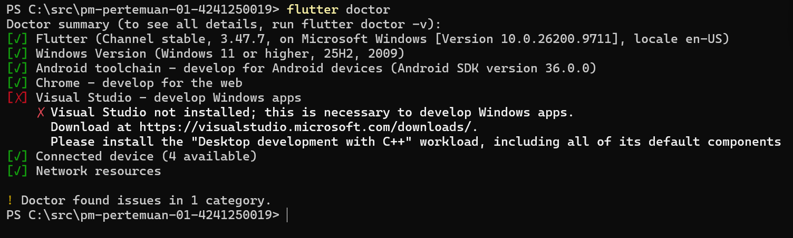
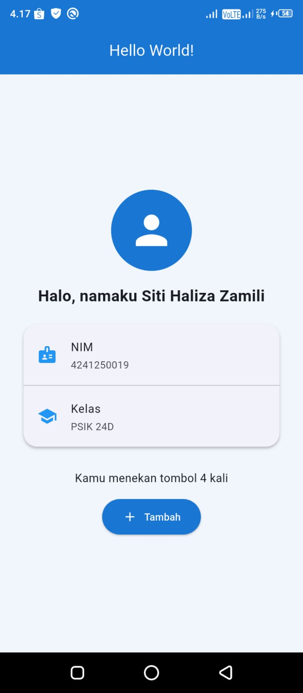

# Pemrograman Mobile - Pertemuan 1

**Nama:** Siti Haliza Zamili
**NIM:** 4241250019
**Kelas:** PSIK 24D

## Deskripsi
Aplikasi Flutter sederhana yang menampilkan Hello World dengan nama, NIM, dan kelas,
serta beberapa widget tambahan: CircleAvatar, Card, ListTile, Icon, dan ElevatedButton.

## Versi Flutter
```
Flutter 3.47.7 • channel stable • https://github.com/flutter/flutter.git
Framework • revision abaf9c5237 (3 weeks ago) • 2026-10-08 09:51:21 -0700
Engine • hash d8a2d6c768c334d53e16277f837970ffa1e2de81 (revision deb287481e) (18 days ago) • 2026-10-07 17:09:12.000Z
Tools • Dart 3.13.5 • DevTools 2.60.0
```

## Tangkapan Layar

### Flutter Doctor


### Aplikasi di HP


## Kendala dan Solusi

### 1. PowerShell executable not found
- **Kendala:** `flutter doctor` menampilkan error "PowerShell executable not found".
- **Penyebab:** folder PowerShell tidak ada di PATH sistem Windows.
- **Solusi:** menambahkan `C:\Windows\System32\WindowsPowerShell\v1.0\` ke System variables > Path, lalu membuka terminal baru.

### 2. Build gagal karena NDK belum terpasang
- **Kendala:** `flutter run` pertama gagal dengan pesan NDK tidak ditemukan.
- **Penyebab:** pemasangan NDK otomatis lewat sdkmanager gagal.
- **Solusi:** memasang NDK secara manual lewat Android Studio > SDK Manager > SDK Tools, lalu menjalankan ulang `flutter run`.

## Pernyataan Penggunaan AI
Dalam mengerjakan tugas ini saya menggunakan Claude (Anthropic) sebagai alat bantu.
Bagian yang dibantu AI:
- Panduan langkah instalasi Git, VS Code, Flutter SDK, Android Studio, dan pengaturan HP Android.
- Memberi contoh kode tampilan aplikasi (`main.dart`) dan kerangka README.
- Menjelaskan perintah Git (init, add, commit, push) dan cara menghubungkan ke GitHub.

Bagian yang saya kerjakan sendiri:
- Membaca dan mencari penyebab error, seperti PATH PowerShell, NDK, dan izin debugging USB.
- Menjalankan semua instalasi dan perintah di laptop saya.
- Menguji aplikasi langsung di HP Infinix X680B saya.
- Memilih tema dan tampilan aplikasi, menyesuaikan nama, NIM, dan kelas.
- Membuat repository, melakukan commit, dan mengunggahnya ke GitHub.
- Membuat Esai perbandingan Native, Hybrid, dan Cross-platform beserta dengan contoh kasusnya